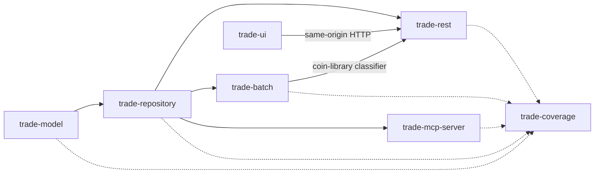

# Application architecture

Source-verified against `719606a`, 16 November 2026. Runtime/test evidence is kept
separately in [Verification](docs/project-understanding/VERIFICATION.md).

## Module dependencies

Arrows from Java modules indicate library consumption. REST retains the Coin-only
classifier dependency and Batch core, excluding the Boot Batch starter. The former
Coin runtime bridge has been removed; that dependency does not imply working uploads.

## Application boundaries

| Area | Current implementation |
|---|---|
| Portfolio REST | Controllers → request-scoped primary owned repositories → bound JDBC SQL |
| Authentication/profile/recovery | Spring Security plus dedicated services and JDBC repositories; BCrypt passwords, session/CSRF, credential-version checks |
| Legacy CSV | `com.trading.kite` runners → Spring Batch readers/processors/writers → JPA trade/ledger repositories |
| Coin | `com.trading.coin.batch` record pipeline scaffolding; no complete job, field mapping or database writer |
| MCP | Separate WebFlux/Spring AI process → raw trade/ledger repositories; no REST owner context |
| UI | React component state and manual navigation; shared `api.js`; custom SVG analytics charts |

[Components](docs/project-understanding/COMPONENTS.md) lists source entry points.
No queue, external broker/NAV integration, admin API, or model inference workflow
is implemented. Declared Ollama/vector/chat dependencies are not application flows.

## Persistence and authorization

Mutual-fund and account/security persistence uses `JdbcTemplate` or
`NamedParameterJdbcTemplate`, explicit SQL and POJOs. Legacy trade/ledger persistence
still uses Spring Data JPA. SQL migrations belong to `trade-repository`.

The authenticated principal fixes the owner for REST broker, fund, transaction and
value repositories. Child access is constrained through broker ownership; client
`ownerUserId` values cannot select a different portfolio. Analytics passes the
principal ID explicitly. Raw trade/ledger tables and MCP queries have no equivalent
user ownership. [Multi-user status](multi-user-support-gap-analysis.md) records gaps.

Registration, profile and recovery use explicit transactional boundaries. Ordinary
portfolio controller validation, mutation and reread are separate operations;
list/count pagination also uses separate queries. There is no general optimistic
locking or request-idempotency mechanism. Legacy batch commits chunks; earlier
chunks can remain after a later failure.

Flyway and Hibernate DDL are disabled by application configuration. V1–V15 define
the intended schema, not the observed state of a deployed database. The retained
7 October catalog snapshot is historical. See [Data model](docs/project-understanding/DATA_MODEL.md).

## Runtime and integration

| Process | Entry point / configuration |
|---|---|
| REST | `com.trading.TradeRestApplication`; dev 6666, prod 8888 |
| Legacy batch JAR | `com.trading.kite.TradeBatchApplication`; ledger runner is also discoverable |
| Coin classifier | POM points to `CoinOrderHistoryBatchApplication`, which currently has no `main` method |
| MCP | Source class `com.trading.TradeMcpServerApplication`; POM incorrectly points to `com.trading.mcp.server.TradeMcpServerApplication` |
| UI | Vite 7777 in development; production Node static/proxy server 9999 |

REST excludes `com.trading.kite` and Coin batch/service/launcher classes from its
component scan. This also protects IDE workspace launches, where the classifier
may resolve to the full batch output. `RestWorkspaceStartupTest` checks that boundary.

Browser requests use same-origin cookies and fresh CSRF tokens for mutations.
SMTP is used for recovery/reminders. Production topology and startup behavior are
owned by [Deployment architecture](DEPLOYMENT_ARCHITECTURE.md).

## Detailed references

[API and UI](docs/project-understanding/CONTRACTS_AND_UI.md),
[business/calculation workflows](docs/project-understanding/WORKFLOWS.md),
[batch behavior](trade-batch/ARCHITECTURE.md), and
[Coin completion gaps](docs/COIN_BATCH_RUNBOOK.md) provide the detailed contracts.
