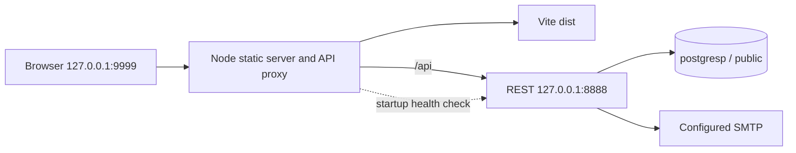

# macOS deployment architecture

Source baseline: `719606a`, 16 November 2026. These are repository templates, not a
claim that services are installed or running. [Installation steps](deploy/macos/README.md)
are maintained separately from this topology summary.

Two per-user LaunchAgents use `RunAtLoad` and `KeepAlive`. REST runs the executable
JAR under Java 25; UI runs [serve-production.mjs](trade-ui/scripts/serve-production.mjs)
under Node. The plist templates use absolute paths for the original developer's
home and must be adapted on another machine.

The UI waits for successful `/actuator/health` **before initially binding**. Once
listening, it does not close/reapply the startup gate when REST restarts; upstream
failures return 502. API responses and cookies are proxied unchanged. Use one
consistent browser origin; localhost and 127.0.0.1 have different cookie origins.
The reset-mail validator accepts HTTP localhost or HTTPS, so align reset links
with the chosen deployment origin and transport.

REST's template sets `SPRING_PROFILES_ACTIVE=prod`, `SERVER_ADDRESS=127.0.0.1` and
`SERVER_PORT=8888`; base application configuration alone does not enforce loopback.
The UI binds loopback on 9999. Templates provide no TLS termination. REST restart
loses in-memory sessions.

Credentials belong in an external mode-600 environment file, never in plists or
Git. The launcher sources it but does not enforce its permissions. Flyway and
Hibernate DDL remain disabled; reconcile migration history before deployment.

The historical deployment archive was generated output, not a checked-in packaging
workflow. Build and copy artifacts using [the deployment guide](deploy/macos/README.md).
Current Coin upload remains incomplete; successful packaging is not feature readiness.
Dated syntax/build/proxy checks are in [Verification](docs/project-understanding/VERIFICATION.md).
