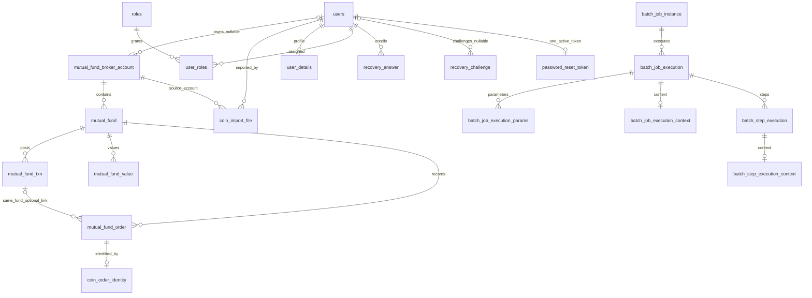

# Data model and schema evidence

Source baseline: `719606a`, reconciled 16 November 2026. The intended schema is
**V1–V15**; running databases were not inspected in this task. The retained catalog
snapshot below is dated **7 October 2026** and covers V1–V13-era structures.
[Migration guidance](../../trade-repository/src/main/resources/db/migration/README.md)
owns deployment procedure; [Contracts](CONTRACTS_AND_UI.md) owns request/response shapes.

## Entity relationships and access

All drawn relationships are SQL FKs in migrations; cardinalities describe permitted schema states, not mandatory application completeness. Users may lack details/roles in externally modified data even though registration creates both. Orders allow many orders to reference one transaction; the composite FK enforces the same fund. No auto-reconciliation or one-order/one-fill constraint exists. Funds have one optional folio each, not a separate folio entity. No relationship joins trade-record ISIN to fund ISIN, ledger to broker/user, or vector/chat tables to users. `trade_records`, `ledger_records`, unused `ledger_balances`, `recovery_rate_limit`, `spring_ai_chat_memory` and `vector_store` are standalone relative to this ERD. [V3__application_schema.sql](../../trade-repository/src/main/resources/db/migration/V3__application_schema.sql), [V5__create_app_user.sql](../../trade-repository/src/main/resources/db/migration/V5__create_app_user.sql), [V6__portfolio_ownership.sql](../../trade-repository/src/main/resources/db/migration/V6__portfolio_ownership.sql), [V7__password_recovery.sql](../../trade-repository/src/main/resources/db/migration/V7__password_recovery.sql), [V9__mutual_fund_orders.sql](../../trade-repository/src/main/resources/db/migration/V9__mutual_fund_orders.sql)

Portfolio FKs use default NO ACTION deletion/update behavior: a broker with funds, fund with children, user with owned brokers, or transaction referenced by orders cannot simply be deleted. There is no soft-delete flag, cascading portfolio API operation or transfer-user API. User details, user-role rows, recovery answers/challenges/tokens cascade when their referenced user is deleted; user-role mappings also cascade with role deletion. There is no user/role delete API. Batch metadata FKs have no cascade; the parameter table has no primary key. No database row-level security is specified by migrations; REST ownership is SQL predicates in the application.

## Migration ledger

| Version | Objects/change | Data/migration implications |
|---|---|---|
| [V1__extensions.sql](../../trade-repository/src/main/resources/db/migration/V1__extensions.sql) | `uuid-ossp`, `vector` extensions | Requires installed extension support/privilege; not ordinary business records |
| [V2__spring_batch_schema.sql](../../trade-repository/src/main/resources/db/migration/V2__spring_batch_schema.sql) | Six Batch tables, three sequences, keys | Framework execution metadata; sequence values generated outside identity columns |
| [V3__application_schema.sql](../../trade-repository/src/main/resources/db/migration/V3__application_schema.sql) | Ledger balances/records, trades, brokers/funds/transactions/values | Base SQL constraints differ from several JPA annotations; no owner yet |
| [V4__spring_ai_schema.sql](../../trade-repository/src/main/resources/db/migration/V4__spring_ai_schema.sql) | Chat memory, vector store, HNSW cosine index | No current first-party consumer; embedding has no dimension in migration; full fresh migration not tested |
| [V5__create_app_user.sql](../../trade-repository/src/main/resources/db/migration/V5__create_app_user.sql) | Roles/users/details/join; seed ROLE_USER | `IF NOT EXISTS` adopts only already-compatible structures; does not repair mismatched existing tables |
| [V6__portfolio_ownership.sql](../../trade-repository/src/main/resources/db/migration/V6__portfolio_ownership.sql) | Nullable broker `owner_user_id` FK; four access-path indexes | No backfill; ownerless data hidden from REST; not proof every broker has an owner |
| [V7__password_recovery.sql](../../trade-repository/src/main/resources/db/migration/V7__password_recovery.sql) | User versions, answers/challenges/tokens/rate counters | Existing users have no automatic recovery answers; expiry is application-enforced |
| [V8__user_profile_hint.sql](../../trade-repository/src/main/resources/db/migration/V8__user_profile_hint.sql) | Separate hint question/hash pair; unique LOWER(email) | Existing case-insensitive duplicates block migration; profile hint does not enroll recovery |
| [V9__mutual_fund_orders.sql](../../trade-repository/src/main/resources/db/migration/V9__mutual_fund_orders.sql) | Fund ISIN/plan; txn units/NAV numeric21,6; orders and same-fund link | Original ISIN 12-character check later removed; widening retains 15 integer digits; no backfill/posting |
| [V10__move_folio_to_mutual_fund.sql](../../trade-repository/src/main/resources/db/migration/V10__move_folio_to_mutual_fund.sql) | Folio moves order → fund | Distinct non-null order folios per fund must agree; scalar subquery fails otherwise; rollback preserves source |
| [V11__move_order_metadata_to_transactions.sql](../../trade-repository/src/main/resources/db/migration/V11__move_order_metadata_to_transactions.sql) | Five TEXT metadata fields move order → linked txn | Temporary constraint rejects unlinked non-null metadata; per-field DISTINCT conflicts reject; same-value and complementary fields combine; no transaction invented; old order columns dropped |
| [V12__unique_broker_account_per_owner.sql](../../trade-repository/src/main/resources/db/migration/V12__unique_broker_account_per_owner.sql) | UNIQUE broker_name/account_id/owner | Standard case/space-sensitive comparison, NULL owners distinct; duplicates fail rather than merge |
| [V13__relax_mutual_fund_isin_length.sql](../../trade-repository/src/main/resources/db/migration/V13__relax_mutual_fund_isin_length.sql) | ISIN becomes optional TEXT, exact-length check removed | N/A/long values legal; no cleanup/normalization of existing source strings |
| [V14](../../trade-repository/src/main/resources/db/migration/V14__coin_order_history_import.sql) | Coin import/file/row/period/identity tables; `btree_gist` | Historical importer schema; no current import repository |
| [V15](../../trade-repository/src/main/resources/db/migration/V15__remove_coin_row_and_period_tracking.sql) | Preserve identity snapshots/file counters; remove three row/period tables | Rejects noncontiguous legacy progress; does not drop orders or the two retained Coin tables |

Migration execution evidence is dated in [Verification](VERIFICATION.md). Current tests cover selected migration paths; they do not establish a complete V1–V15 installation. Applied migrations remain immutable.

## Value provenance and normalization

| Data | Origin → stored form → consumers | Omitted / explicit null / empty / whitespace |
|---|---|---|
| Broker name/account ID | UI/manual API → varchar → owner CRUD/fund labels/portfolio | No Bean Validation on broker body. Missing/null fails SQL NN; empty or spaces can persist. IDs remain String so leading zeros survive. V12 uniqueness uses exact stored text. |
| Fund name/parent | UI/manual API → required name/owned broker FK → CRUD/analytics | API name NotBlank; UI trims name. Parent positive and must be visible to owner. Not a globally unique scheme/security identifier. |
| Fund ISIN/plan/folio | Optional source facts → nullable TEXT → fund forms/table | Create missing/null/`""` → SQL NULL. Update missing/null preserves old field; `""` clears to SQL NULL. Spaces are preserved in SQL; UI trims ISIN, not plan/folio. N/A is literal valid text. |
| Completed txn numeric/direction/date | UI/API → BigDecimal/BUY-or-SELL/date at midnight → summaries/holdings/returns | Amount/units/avgPrice required and >=0 at HTTP boundary. Omitted and explicit null both invalid; zero is legal. Direction missing/null/lowercase/arbitrary invalid JSON enum. No amount=units×price or oversell validation. |
| Txn metadata | Optional status/reference/remarks/tag → TEXT → DTO/details | Create missing/null → NULL, empty preserved. Update missing/null preserves; empty stored verbatim (cannot clear to SQL NULL through this PUT). No trimming/case/status vocabulary/JSON parsing. IDs may repeat across transactions, include leading zeros or N/A. |
| Order fields | Retained SQL schema only; Java order model/repositories were removed | No current order API, persistence adapter or lifecycle handling. SQL still permits nullable source facts and optional same-fund transaction links. |
| Valuation | Manual UI/API → total amount/date → management and analytics snapshots | Both required; amount >=0 through API. No unique fund/day or NAV-derived calculation. Missing snapshot is different from recorded zero. |
| User/profile | Registration + profile UI/API → users/details → safe profile/session | Registration constraints differ from profile normalization. Profile optional basics null/omitted/blank → NULL; nonblank strip. Hint absent/null pair preserves; supplying one without the other invalid. Unknown profile properties/query params rejected. Email not stripped by profile service. |
| Recovery answer | Three user answers → NFKC + strip + lowercase + SHA-256 + BCrypt → answer checks only | Three unique question IDs needed; answers NotBlank/max256. Hashes never JSON responses. Separate single profile hint hashes exact raw text via SHA-256 + BCrypt. |
| Trade CSV | Positional source → trim-to-null text, numeric/date parsing → JPA → MCP | String order ID keeps zeros; Long trade ID/Integer quantity do not preserve numeric formatting. N/A/blank numeric/date fails parse. Trade type requires lower-case buy/sell. |
| Ledger CSV | Positional source → mapped text/numbers/date + generated absolute filename/time → JPA → MCP | Mapper parses net balance even though SQL allows NULL. Whitespace text stripped; no source-text fidelity guarantee as in fund metadata. |

Evidence: [OwnedFundRepository.java](../../trade-repository/src/main/java/com/trading/repository/impl/OwnedFundRepository.java), [OwnedTxnRepository.java](../../trade-repository/src/main/java/com/trading/repository/impl/OwnedTxnRepository.java), [MutualFundTxnDto.java](../../trade-rest/src/main/java/com/trading/dto/MutualFundTxnDto.java), [MutualFundValueDto.java](../../trade-rest/src/main/java/com/trading/dto/MutualFundValueDto.java), [UserProfileService.java](../../trade-rest/src/main/java/com/trading/profile/UserProfileService.java), [PasswordRecoveryService.java](../../trade-rest/src/main/java/com/trading/recovery/PasswordRecoveryService.java), [TradeFieldSetMapper.java](../../trade-batch/src/main/java/com/trading/kite/batch/reader/mapper/TradeFieldSetMapper.java), [LedgerRecordFieldSetMapper.java](../../trade-batch/src/main/java/com/trading/kite/batch/reader/mapper/LedgerRecordFieldSetMapper.java), [MutualFunds.jsx](../../trade-ui/src/components/MutualFunds.jsx), [MutualFundTransactions.jsx](../../trade-ui/src/components/MutualFundTransactions.jsx).

Dates: persistence portfolio/trade audit columns are `TIMESTAMP WITHOUT TIME ZONE` and Java `LocalDateTime`; order day/time remain separate SQL date/time columns, with no active order Java model or inferred zone. HTTP txn/value DTOs accept strict English `dd-MMM-uuuu`, ISO date or ISO timestamp, retain its calendar date and store midnight; supplied offset is not converted to another zone. Read responses use `DD-Mon-YYYY`; analytics value history returns the model's ISO local timestamp instead. User/recovery SQL uses timestamptz, with recovery expiry passed as `Instant`/`Timestamp.from`; profile/user audit timestamps are not exposed by safe models. [MutualFundTxnDto.java](../../trade-rest/src/main/java/com/trading/dto/MutualFundTxnDto.java), [MutualFundValueDto.java](../../trade-rest/src/main/java/com/trading/dto/MutualFundValueDto.java), [JdbcPasswordRecoveryRepository.java](../../trade-repository/src/main/java/com/trading/repository/impl/JdbcPasswordRecoveryRepository.java), [date.js](../../trade-ui/src/utils/date.js)

Precision: monetary txn/order/value amounts numeric(18,2), units and NAV numeric(21,6), raw trade/ledger values numeric(15,6). BigDecimal passes directly to SQL; there is no explicit common rounding policy before persistence, so the database coerces to declared scale or rejects overflow. Analytics percentages explicitly use HALF_UP to scale6; JavaScript Number arithmetic and locale formatting are not exact decimal storage. Numeric JSON is unquoted; Long IDs can exceed browser safe integer precision in principle. UI displays often round without changing stored values, but transaction input step .001 prevents normal six-place input. Source values beyond six fractional places are not losslessly supported. [JdbcAnalyticsRepository.java](../../trade-repository/src/main/java/com/trading/repository/impl/JdbcAnalyticsRepository.java), [MutualFundTransactions.jsx](../../trade-ui/src/components/MutualFundTransactions.jsx), [advancedReturnMetrics.js](../../trade-ui/src/components/advancedReturnMetrics.js)

Audit defaults are insertion defaults, not update triggers. JDBC portfolio updates explicitly set update_date; ignored client audit fields cannot rewrite stored creation time. Valuations have **no create/update audit columns**. Raw trade constructor assigns createdAt; ledger processor assigns createDateTime. No audit actor/action trail exists. **R, 7 October only:** neither inspected database had public-schema triggers; no current catalog check was made.

## Column dictionary

`NN` = NOT NULL; `NULL` = nullable; blank default means none. JSON names are exact source bean/record property names where exposed. “internal” means no current public JSON contract; Batch/AI columns have no first-party mapped Java DTO. Keys/checks and explicit non-PK indexes follow the tables. This is the intended migration-defined layout. Historical catalog differences are isolated in the dated comparison below; current source mappings were reconciled on 16 November.

### `mutual_fund_broker_account`

Schema: [V3__application_schema.sql](../../trade-repository/src/main/resources/db/migration/V3__application_schema.sql), [V6__portfolio_ownership.sql](../../trade-repository/src/main/resources/db/migration/V6__portfolio_ownership.sql), [V12__unique_broker_account_per_owner.sql](../../trade-repository/src/main/resources/db/migration/V12__unique_broker_account_per_owner.sql). Model: [MutualFundBrokerAccount.java](../../trade-model/src/main/java/com/trading/model/MutualFundBrokerAccount.java).

| Column | SQL type | Null/default/generation | Java property/type | JSON representation |
|---|---|---|---|---|
| `broker_account_id` | bigint | NN; identity BY DEFAULT | Long id | `id`: number |
| `broker_name` | character varying(255) | NN | String brokerName | `brokerName`: string |
| `account_id` | character varying(100) | NN | String accountId | `accountId`: string |
| `create_date` | timestamp without time zone | NN; default CURRENT_TIMESTAMP | LocalDateTime createDate | `createDate`: string ISO date/time |
| `update_date` | timestamp without time zone | NN; default CURRENT_TIMESTAMP | LocalDateTime updateDate | `updateDate`: string ISO date/time |
| `owner_user_id` | bigint | NULL | Long ownerUserId; fixed ownerId in owned SQL | `ownerUserId` bean property exists; owned row mapper currently leaves it null |

Keys/checks: `PRIMARY KEY (broker_account_id)`; `FOREIGN KEY (owner_user_id) REFERENCES users(id)`; `UNIQUE (broker_name, account_id, owner_user_id) — V12 intended; absent in 7 October catalogs`.

### `mutual_fund`

Schema: [V3__application_schema.sql](../../trade-repository/src/main/resources/db/migration/V3__application_schema.sql), [V9__mutual_fund_orders.sql](../../trade-repository/src/main/resources/db/migration/V9__mutual_fund_orders.sql), [V10__move_folio_to_mutual_fund.sql](../../trade-repository/src/main/resources/db/migration/V10__move_folio_to_mutual_fund.sql), [V13__relax_mutual_fund_isin_length.sql](../../trade-repository/src/main/resources/db/migration/V13__relax_mutual_fund_isin_length.sql). Model: [MutualFund.java](../../trade-model/src/main/java/com/trading/model/MutualFund.java).

| Column | SQL type | Null/default/generation | Java property/type | JSON representation |
|---|---|---|---|---|
| `mutual_fund_id` | bigint | NN; identity ALWAYS | Long mutualFundId | `mutualFundId`: number |
| `broker_account_id` | bigint | NN | Long brokerAccountId | `brokerAccountId`: number |
| `mutual_fund_name` | character varying(255) | NN | String mutualFundName | `mutualFundName`: string |
| `create_date` | timestamp without time zone | NN; default CURRENT_TIMESTAMP | LocalDateTime createDate | `createDate`: string ISO date/time |
| `update_date` | timestamp without time zone | NN; default CURRENT_TIMESTAMP | LocalDateTime updateDate | `updateDate`: string ISO date/time |
| `isin` | text | NULL | String isin | `isin`: string |
| `plan` | text | NULL | String plan | `plan`: string |
| `folio_number` | text | NULL | String folioNumber | `folioNumber`: string |

Keys/checks: `FOREIGN KEY (broker_account_id) REFERENCES mutual_fund_broker_account(broker_account_id)`; `PRIMARY KEY (mutual_fund_id)`.

### `mutual_fund_txn`

Schema: [V3__application_schema.sql](../../trade-repository/src/main/resources/db/migration/V3__application_schema.sql), [V9__mutual_fund_orders.sql](../../trade-repository/src/main/resources/db/migration/V9__mutual_fund_orders.sql), [V11__move_order_metadata_to_transactions.sql](../../trade-repository/src/main/resources/db/migration/V11__move_order_metadata_to_transactions.sql). Model: [MutualFundTxn.java](../../trade-model/src/main/java/com/trading/model/MutualFundTxn.java).

| Column | SQL type | Null/default/generation | Java property/type | JSON representation |
|---|---|---|---|---|
| `mutual_fund_txn_id` | bigint | NN; identity ALWAYS | Long mutualFundTxnId | `mutualFundTxnId`: number |
| `mutual_fund_id` | bigint | NN | Long mutualFundId | `mutualFundId`: number |
| `amount` | numeric(18,2) | NN | BigDecimal amount | `amount`: number |
| `create_date` | timestamp without time zone | NN; default CURRENT_TIMESTAMP | LocalDateTime createDate | `createDate`: string ISO date/time |
| `update_date` | timestamp without time zone | NN; default CURRENT_TIMESTAMP | LocalDateTime updateDate | `updateDate`: string ISO date/time |
| `txn_date` | timestamp without time zone | NN | LocalDateTime txnDate | `txnDate`: string DD-Mon-YYYY |
| `units` | numeric(21,6) | NN; default 0 | BigDecimal units | `units`: number |
| `avg_price` | numeric(21,6) | NN; default 0 | BigDecimal avgPrice | `avgPrice`: number |
| `txn_type` | character varying | NN; default 'BUY'::character varying | TransactionType transactionType | `transactionType`: string BUY/SELL |
| `status` | text | NULL | String status | `status`: string |
| `exchange_order_id` | text | NULL | String exchangeOrderId | `exchangeOrderId`: string |
| `remarks` | text | NULL | String remarks | `remarks`: string |
| `tag` | text | NULL | String tag | `tag`: string |
| `settlement_id` | text | NULL | String settlementId | `settlementId`: string |

Keys/checks: `FOREIGN KEY (mutual_fund_id) REFERENCES mutual_fund(mutual_fund_id)`; `PRIMARY KEY (mutual_fund_txn_id)`; `UNIQUE (mutual_fund_txn_id, mutual_fund_id)`.

### `mutual_fund_value`

Schema: [V3__application_schema.sql](../../trade-repository/src/main/resources/db/migration/V3__application_schema.sql). Model: [MutualFundValue.java](../../trade-model/src/main/java/com/trading/model/MutualFundValue.java).

| Column | SQL type | Null/default/generation | Java property/type | JSON representation |
|---|---|---|---|---|
| `val_id` | bigint | NN; identity ALWAYS | Long valId | `valId`: number |
| `mutual_fund_id` | bigint | NN | Long mutualFundId | `mutualFundId`: number |
| `total_value` | numeric(18,2) | NN | BigDecimal totalValue | `totalValue`: number |
| `value_as_of_date` | timestamp without time zone | NN | LocalDateTime valueAsOfDate | `valueAsOfDate`: string DD-Mon-YYYY; analytics model timestamp ISO |

Keys/checks: `FOREIGN KEY (mutual_fund_id) REFERENCES mutual_fund(mutual_fund_id)`; `PRIMARY KEY (val_id)`.

### `mutual_fund_order`

Schema: [V9__mutual_fund_orders.sql](../../trade-repository/src/main/resources/db/migration/V9__mutual_fund_orders.sql), [V10__move_folio_to_mutual_fund.sql](../../trade-repository/src/main/resources/db/migration/V10__move_folio_to_mutual_fund.sql), [V11__move_order_metadata_to_transactions.sql](../../trade-repository/src/main/resources/db/migration/V11__move_order_metadata_to_transactions.sql). The Java model/repositories were removed; this table remains in SQL only.

| Column | SQL type | Null/default/generation |
|---|---|---|
| `mutual_fund_order_id` | bigint | NN; identity ALWAYS |
| `mutual_fund_id` | bigint | NN |
| `mutual_fund_txn_id` | bigint | NULL |
| `txn_type` | character varying | NULL |
| `trade_date` | date | NULL |
| `ordered_at` | time without time zone | NULL |
| `amount` | numeric(18,2) | NULL |
| `units` | numeric(21,6) | NULL |
| `avg_price` | numeric(21,6) | NULL |
| `create_date` | timestamp without time zone | NN; default CURRENT_TIMESTAMP |
| `update_date` | timestamp without time zone | NN; default CURRENT_TIMESTAMP |

Keys/checks: `FOREIGN KEY (mutual_fund_txn_id, mutual_fund_id) REFERENCES mutual_fund_txn(mutual_fund_txn_id, mutual_fund_id)`; `FOREIGN KEY (mutual_fund_id) REFERENCES mutual_fund(mutual_fund_id)`; `PRIMARY KEY (mutual_fund_order_id)`.

### `trade_records`

Schema: [V3__application_schema.sql](../../trade-repository/src/main/resources/db/migration/V3__application_schema.sql). Model: [TradeRecord.java](../../trade-model/src/main/java/com/trading/model/TradeRecord.java).

| Column | SQL type | Null/default/generation | Java property/type | JSON representation |
|---|---|---|---|---|
| `id` | uuid | NN | UUID id | `id`: string UUID; no direct HTTP endpoint (aggregates only) |
| `symbol` | character varying(50) | NN | String symbol | `symbol`: string; no direct HTTP endpoint (aggregates only) |
| `isin` | character varying(50) | NULL | String isin | `isin`: string; no direct HTTP endpoint (aggregates only) |
| `trade_date` | date | NN | LocalDate tradeDate | `tradeDate`: string ISO date/time; no direct HTTP endpoint (aggregates only) |
| `exchange` | character varying(50) | NN | String exchange | `exchange`: string; no direct HTTP endpoint (aggregates only) |
| `segment` | character varying(50) | NULL | String segment | `segment`: string; no direct HTTP endpoint (aggregates only) |
| `series` | character varying(50) | NULL | String series | `series`: string; no direct HTTP endpoint (aggregates only) |
| `trade_type` | character varying(10) | NULL | String tradeType | `tradeType`: string; no direct HTTP endpoint (aggregates only) |
| `auction` | boolean | NULL; default false | Boolean auction | `auction`: boolean; no direct HTTP endpoint (aggregates only) |
| `quantity` | numeric(15,6) | NN | Integer quantity | `quantity`: number; no direct HTTP endpoint (aggregates only) |
| `price` | numeric(15,6) | NN | BigDecimal price | `price`: number; no direct HTTP endpoint (aggregates only) |
| `trade_id` | bigint | NULL | Long tradeId | `tradeId`: number; no direct HTTP endpoint (aggregates only) |
| `order_id` | character varying(100) | NULL | String orderId | `orderId`: string; no direct HTTP endpoint (aggregates only) |
| `order_execution_time` | timestamp without time zone | NULL | LocalDateTime orderExecutionTime | `orderExecutionTime`: string ISO date/time; no direct HTTP endpoint (aggregates only) |
| `created_at` | timestamp without time zone | NULL; default CURRENT_TIMESTAMP | LocalDateTime createdAt | `createdAt`: string ISO date/time; no direct HTTP endpoint (aggregates only) |

Keys/checks: `PRIMARY KEY (id)`; `CHECK (((trade_type)::text = ANY (ARRAY[('buy'::character varying)::text, ('sell'::character varying)::text])))`.

### `ledger_records`

Schema: [V3__application_schema.sql](../../trade-repository/src/main/resources/db/migration/V3__application_schema.sql). Model: [LedgerRecord.java](../../trade-model/src/main/java/com/trading/model/LedgerRecord.java).

| Column | SQL type | Null/default/generation | Java property/type | JSON representation |
|---|---|---|---|---|
| `ledger_record_id` | uuid | NN | UUID ledgerRecordId | `ledgerRecordId`: string UUID |
| `particulars` | character varying(1000) | NN | String particulars | `particulars`: string |
| `posting_date` | date | NN | LocalDate postingDate | `postingDate`: string ISO date/time |
| `cost_center` | character varying(50) | NN | String costCenter | `costCenter`: string |
| `voucher_type` | character varying(50) | NULL | String voucherType | `voucherType`: string |
| `debit` | numeric(15,6) | NN | BigDecimal debit | `debit`: number |
| `credit` | numeric(15,6) | NN | BigDecimal credit | `credit`: number |
| `net_balance` | numeric(15,6) | NULL | BigDecimal netBalance | `netBalance`: number |
| `file_name` | character varying(500) | NN | String fileName | `fileName`: string |
| `create_date_time` | timestamp without time zone | NN | LocalDateTime createDateTime | `createDateTime`: string ISO date/time |

Keys/checks: `PRIMARY KEY (ledger_record_id)`.

### `ledger_balances`

Schema: [V3__application_schema.sql](../../trade-repository/src/main/resources/db/migration/V3__application_schema.sql). Model: [LedgerBalances.java](../../trade-model/src/main/java/com/trading/model/LedgerBalances.java).

| Column | SQL type | Null/default/generation | Java property/type | JSON representation |
|---|---|---|---|---|
| `ledger_balance_id` | uuid | NN | UUID ledgerBalanceId | `ledgerBalanceId`: string UUID; no direct HTTP endpoint |
| `balance_type` | character varying(100) | NN | String balanceType | `balanceType`: string; no direct HTTP endpoint |
| `net_balance` | numeric(15,6) | NN | BigDecimal netBalance | `netBalance`: number; no direct HTTP endpoint |
| `posting_date` | date | NN | LocalDate postingDate | `postingDate`: string ISO date/time; no direct HTTP endpoint |
| `file_name` | character varying(500) | NN | String fileName | `fileName`: string; no direct HTTP endpoint |
| `create_date_time` | timestamp without time zone | NN | no model field | not exposed (mapping gap) |

Keys/checks: `PRIMARY KEY (ledger_balance_id)`.

### `users`

Schema: [V5__create_app_user.sql](../../trade-repository/src/main/resources/db/migration/V5__create_app_user.sql), [V7__password_recovery.sql](../../trade-repository/src/main/resources/db/migration/V7__password_recovery.sql).

| Column | SQL type | Null/default/generation | Java property/type | JSON representation |
|---|---|---|---|---|
| `id` | bigint | NN; default sequence (SERIAL/BIGSERIAL) | long id/userId | number in session/registration/profile |
| `username` | character varying(50) | NN | String username | string |
| `email` | character varying(100) | NN | String email | string in registration/profile |
| `password` | character varying(100) | NN | String passwordHash | never exposed |
| `enabled` | boolean | NN; default true | boolean enabled | internal |
| `account_non_expired` | boolean | NN; default true | boolean accountNonExpired | internal |
| `account_non_locked` | boolean | NN; default true | boolean accountNonLocked | internal |
| `credentials_non_expired` | boolean | NN; default true | boolean credentialsNonExpired | internal |
| `created_at` | timestamp with time zone | NULL; default CURRENT_TIMESTAMP | no exposed field | internal |
| `credential_version` | bigint | NN; default 0 | long credentialVersion | internal |
| `recovery_version` | bigint | NN; default 0 | long recoveryVersion | internal |

Keys/checks: `UNIQUE (email)`; `PRIMARY KEY (id)`; `UNIQUE (username)`.

### `user_details`

Schema: [V5__create_app_user.sql](../../trade-repository/src/main/resources/db/migration/V5__create_app_user.sql), [V8__user_profile_hint.sql](../../trade-repository/src/main/resources/db/migration/V8__user_profile_hint.sql).

| Column | SQL type | Null/default/generation | Java property/type | JSON representation |
|---|---|---|---|---|
| `user_id` | bigint | NN | long userId | number in profile |
| `first_name` | character varying(50) | NULL | String firstName | string in profile |
| `last_name` | character varying(50) | NULL | String lastName | string in profile |
| `phone_number` | character varying(20) | NULL | String phoneNumber | string in profile |
| `avatar_url` | character varying(255) | NULL | String avatarUrl | string in profile |
| `updated_at` | timestamp with time zone | NULL; default CURRENT_TIMESTAMP | no exposed field | internal |
| `hint_question_id` | integer | NULL | Integer hintQuestion | number/null |
| `hint_answer_hash` | character varying(100) | NULL | String hintAnswerHash | never exposed; hintAnswerSet boolean only |

Keys/checks: `CHECK ((((hint_question_id IS NULL) AND (hint_answer_hash IS NULL)) OR ((hint_question_id IS NOT NULL) AND ((hint_question_id >= 1) AND (hint_question_id <= 3)) AND (hint_answer_hash IS NOT NULL))))`; `FOREIGN KEY (user_id) REFERENCES users(id) ON DELETE CASCADE`; `PRIMARY KEY (user_id)`.

### `roles`

Schema: [V5__create_app_user.sql](../../trade-repository/src/main/resources/db/migration/V5__create_app_user.sql).

| Column | SQL type | Null/default/generation | Java property/type | JSON representation |
|---|---|---|---|---|
| `id` | integer | NN; default sequence (SERIAL/BIGSERIAL) | no first-party role-ID model | internal |
| `name` | character varying(50) | NN | String in Set<String> roles | roles: string[] |

Keys/checks: `UNIQUE (name)`; `PRIMARY KEY (id)`.

### `user_roles`

Schema: [V5__create_app_user.sql](../../trade-repository/src/main/resources/db/migration/V5__create_app_user.sql).

| Column | SQL type | Null/default/generation | Java property/type | JSON representation |
|---|---|---|---|---|
| `user_id` | bigint | NN | long SQL parameter | internal |
| `role_id` | integer | NN | SQL join key | internal |

Keys/checks: `FOREIGN KEY (role_id) REFERENCES roles(id) ON DELETE CASCADE`; `FOREIGN KEY (user_id) REFERENCES users(id) ON DELETE CASCADE`; `PRIMARY KEY (user_id, role_id)`.

### `recovery_answer`

Schema: [V7__password_recovery.sql](../../trade-repository/src/main/resources/db/migration/V7__password_recovery.sql).

| Column | SQL type | Null/default/generation | Java property/type | JSON representation |
|---|---|---|---|---|
| `user_id` | bigint | NN | long SQL parameter | internal |
| `question_id` | integer | NN | Integer map key / int questionId | questionId in enrollment only |
| `answer_hash` | character varying(100) | NN | String map value | never exposed |

Keys/checks: `PRIMARY KEY (user_id, question_id)`; `CHECK (((question_id >= 1) AND (question_id <= 3)))`; `FOREIGN KEY (user_id) REFERENCES users(id) ON DELETE CASCADE`.

### `recovery_challenge`

Schema: [V7__password_recovery.sql](../../trade-repository/src/main/resources/db/migration/V7__password_recovery.sql).

| Column | SQL type | Null/default/generation | Java property/type | JSON representation |
|---|---|---|---|---|
| `challenge_hash` | character varying(64) | NN | String hash | never; raw challengeId returned separately |
| `user_id` | bigint | NULL | Long userId | internal |
| `account_key` | character varying(64) | NN | String accountKey | internal |
| `recovery_version` | bigint | NN | long recoveryVersion | internal |
| `question_one` | integer | NN | int questionOne | questions[].id |
| `question_two` | integer | NN | int questionTwo | questions[].id |
| `expires_at` | timestamp with time zone | NN | Instant SQL parameter | expiresInSeconds=600, not stored timestamp |
| `attempts` | integer | NN; default 0 | SQL counter, not mapped | internal |
| `consumed` | boolean | NN; default false | SQL boolean, not mapped | internal |

Keys/checks: `CHECK ((question_one <> question_two))`; `PRIMARY KEY (challenge_hash)`; `CHECK (((question_one >= 1) AND (question_one <= 3)))`; `CHECK (((question_two >= 1) AND (question_two <= 3)))`; `FOREIGN KEY (user_id) REFERENCES users(id) ON DELETE CASCADE`.

### `password_reset_token`

Schema: [V7__password_recovery.sql](../../trade-repository/src/main/resources/db/migration/V7__password_recovery.sql).

| Column | SQL type | Null/default/generation | Java property/type | JSON representation |
|---|---|---|---|---|
| `token_hash` | character varying(64) | NN | String tokenHash | never; raw token only in mail fragment/request |
| `user_id` | bigint | NN | long SQL parameter | internal |
| `expires_at` | timestamp with time zone | NN | Instant SQL parameter | internal |

Keys/checks: `PRIMARY KEY (token_hash)`; `FOREIGN KEY (user_id) REFERENCES users(id) ON DELETE CASCADE`; `UNIQUE (user_id)`.

### `recovery_rate_limit`

Schema: [V7__password_recovery.sql](../../trade-repository/src/main/resources/db/migration/V7__password_recovery.sql).

| Column | SQL type | Null/default/generation | Java property/type | JSON representation |
|---|---|---|---|---|
| `bucket_key` | character varying(100) | NN | String bucket | internal |
| `attempts` | integer | NN | SQL counter | internal |
| `expires_at` | timestamp with time zone | NN | Instant now/until parameter | internal |

Keys/checks: `PRIMARY KEY (bucket_key)`.

### Retained Coin tables after V15

These tables have no active import repository in this checkpoint. Exact DDL is in
[V14](../../trade-repository/src/main/resources/db/migration/V14__coin_order_history_import.sql)
and [V15](../../trade-repository/src/main/resources/db/migration/V15__remove_coin_row_and_period_tracking.sql).

| Table / column group | Type and constraints |
|---|---|
| `coin_import_file.import_file_id` | BIGINT identity primary key |
| Owner/account/source identity | Non-null BIGINT `owner_user_id`, `broker_account_id` FKs; TEXT `source_system` fixed to ZERODHA_COIN; 64-character lowercase hex `content_sha256`; unique owner/account/source/hash, plus file/owner |
| Source preservation | Non-null BIGINT `byte_count` >= 0; BYTEA `raw_header`; TEXT `managed_file_ref` |
| Parsing/policy | Non-null TEXT `parser_version`, `policy_version`, `date_format`, `posting_policy`; JSONB `configuration_snapshot`, `fund_mapping` |
| Bounds/status | Finite DATE `period_start`, `period_end` with start <= end; TEXT `import_status` in RESERVED/STAGED/COMPLETED/FAILED; BIGINT `record_count` > 0 |
| Progress | Non-null BIGINT `processed_count`, `inserted_count`, `updated_count`, `unchanged_count`, `posted_count`, default 0; nonnegative, processed = inserted + updated + unchanged <= record count, posted <= processed |
| Audit | Non-null TIMESTAMPTZ `created_at`, `updated_at` default current timestamp; nullable `completed_at` |
| `coin_order_identity` key | BIGINT owner/account FKs plus VARCHAR(64) lowercase hex `exchange_id_sha256` primary key; nonempty TEXT `exchange_order_id` |
| Order/fund links | Non-null BIGINT `mutual_fund_id` FK and unique `mutual_fund_order_id` FK |
| Snapshot/status | TEXT `source_status`; TEXT[] `source_fields`, exactly 16 non-null values; TIMESTAMPTZ creation/update defaults |

V15 copies source fields in the [documented CSV order](../../coin-order-schema.md),
backfills file counters and rejects gaps that cannot be represented by a sequential
checkpoint. It then drops `latest_row_id`, `coin_import_row`,
`coin_import_file_fund` and `coin_import_period`. Old import workers require these
objects and must stop before an upgrade. `btree_gist` remains installed if created.
Schema constraints and counters alone do not provide current replay/restart behavior.

### Framework and unused tables

| Tables | Authoritative DDL / current use |
|---|---|
| `batch_job_instance`, `batch_job_execution`, `batch_job_execution_params`, `batch_step_execution`, `batch_job_execution_context`, `batch_step_execution_context` | [V2](../../trade-repository/src/main/resources/db/migration/V2__spring_batch_schema.sql); job/step IDs, status/timestamps, counts and serialized execution context; three BIGINT sequences; legacy runtime use is unverified |
| `spring_ai_chat_memory`, `vector_store` | [V4](../../trade-repository/src/main/resources/db/migration/V4__spring_ai_schema.sql); no first-party application consumer; vector dimension/index fresh-install compatibility unresolved |
| `flyway_schema_history` | Framework-owned operational metadata; no application model. Historical snapshot contains version/type/success only, not operator identities |

Primary/unique constraints create their own indexes. Additional indexes cover
owner/parent lookups (V6), recovery user/expiry (V7), lowercased email (V8), order
links (V9), vector cosine search (V4), and retained Coin owner/account/status (V14).
There is no fund ISIN/name/folio or valuation-day uniqueness. Transaction exchange
IDs are nonunique; Coin identity uniqueness is separate and currently unused by code.
SQL defines no general audit triggers. Java supplies legacy trade/ledger UUIDs;
external account/order/folio strings have independent identity semantics.

## Live schema comparison

**Historical R; not refreshed for the current checkout:** read-only catalog queries on **7 October 2026 around 02:24 IST, repeated at 02:46 IST with the synthetic SQL probe** connected to `127.0.0.1:5432`, databases `postgresd` and `postgresp`, schema `public`; PostgreSQL **18.4 (Homebrew)**. Each connection forced `default_transaction_read_only=on`, statement timeout10s, connect timeout3s. Queried information_schema/pg_catalog plus only Flyway version/type/success. No business records, user credentials, balances, counts of private data, or sequence current values were read. The snapshot additionally includes synthetic fast-lane query output from VALUES rows that shadowed the table; it contains no stored trade data. [Raw catalog snapshot](SCHEMA_SNAPSHOT.json) retains exact definitions, nullability, defaults, key/index names, types, extensions and sequences.

| Aspect | Intended V1–V13 | Observed dev | Observed prod |
|---|---|---|---|
| Migration tables | 24 tables /168 columns, plus Flyway-created history when managed | All24 plus history (25/178) | 23 plus history (24/174); vector_store absent |
| Broker ID | BIGINT GENERATED BY DEFAULT AS IDENTITY | bigint with `nextval` of existing broker sequence, not identity | Same as dev |
| V12 uniqueness | UNIQUE broker_name/account_id/owner_user_id | **Absent**, no equivalent unique index | **Absent**, no equivalent unique index |
| Fund metadata/txn precision and metadata/order layout | Final V13 TEXT ISIN; fund folio; txn five TEXT fields; units/NAV21,6; lean order | Present | Present |
| Main owner/parent/same-fund FKs | As described above | Present | Present |
| V8 hint/email rule | Hint pair check and unique LOWER(email) | Present | Present |
| V4 embedding | VECTOR with unspecified dimension plus HNSW cosine | **vector(768)**, index present | Table absent |
| V1 extensions | plpgsql + uuid-ossp + vector | All; vector0.8.6 | Only plpgsql |
| Flyway history | Applied ordered migrations would be recorded | **One successful BASELINE version1 only** | **One successful BASELINE version1 only** |
| Extra indexes | No standalone username/email indexes beyond unique keys | Additional nonunique `idx_users_username`, `idx_users_email` | Same |
| Triggers | None defined | None in public | None in public |

Different PK/FK names in adopted tables are visible in the snapshot; column names/types/nullability otherwise match the composed final business/auth/Batch/chat schema checked here. This is a catalog comparison, not a row-integrity/backfill/operational-privilege audit. Foreign keys do not show whether ownerless rows exist; no data was sampled. Existing dimensioned vector index does not prove fresh V4 works with an undimensioned vector. Extension availability in prod is an observable fresh-install dependency gap even though current application flows do not consume vector/chat tables.

**U:** historical manual migration sequence, required reconciliation approach, actual broker duplicates/unassigned owners, database deployment privileges and fresh V1–V13 path. Those require a separate data/migration task; none was inferred from history or altered here.
